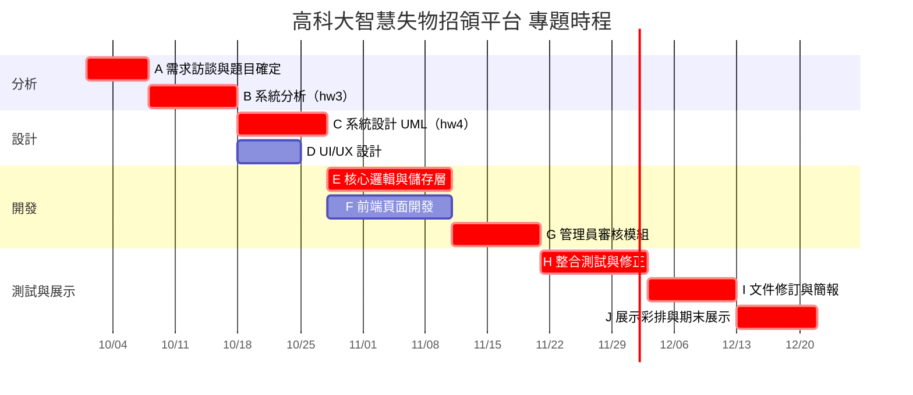
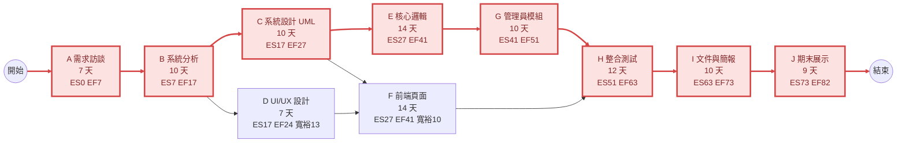

# 高科大智慧失物招領平台

> 「系統分析與設計」課程四人小組專題・**課堂展示原型**
> 本專題為課程作品，非國立高雄科技大學官方系統。所有物品、帳號、學號皆為虛構模擬資料。

---

## 作業 1：專題基本資料

### 組員

| 角色 | 姓名 | 學號 |
|---|---|---|
| 組長 | ○○○ | ○○○○○○○○ |
| 組員 | ○○○ | ○○○○○○○○ |
| 組員 | ○○○ | ○○○○○○○○ |
| 組員 | ○○○ | ○○○○○○○○ |

> 請自行替換為真實姓名與學號。

### 專題名稱

高科大智慧失物招領平台

### 專題背景

校園內經常有師生遺失或拾獲物品（拾獲者也可能是校外人士），但失物資訊分散在社群平台、公告欄與人工紀錄中，失主不容易找到物品。公開貼文常附上物品照片與細節，反而讓冒領者能照著描述領走物品。

### 專題目的

1. 集中各校區的拾獲物品資訊，讓失主可以瀏覽、搜尋與依類別篩選。
2. 將物品資訊分為「公開資訊」與「非公開驗證資訊」，只讓管理員看到驗證細節。
3. 透過認領申請、特徵比對、管理員人工審核與現場核對，降低冒領風險。
4. 以站內通知讓申請人掌握處理進度。

核心理念：**讓真正的失主容易找到物品，但不讓冒領者輕易取得認領所需的關鍵資訊。**

### 專題內容

| 角色 | 可以做的事 |
|---|---|
| 一般使用者（訪客） | 瀏覽、搜尋、篩選、查看公開物品資訊 |
| 拾獲者（高科大師生或校外人士） | 登入後刊登拾獲物品，填寫公開資訊與非公開驗證特徵；物品必須是在高科大校內撿到的 |
| 認領者（高科大師生或校外人士） | 登入後提出認領申請、自行描述特徵、補充資料、查看進度與通知；校外人士學號免填 |
| 管理員 | 查看非公開驗證特徵、核准／拒絕／要求補充、現場核對後確認完成領取、下架物品 |

主要功能：首頁、失物列表、搜尋與分類篩選、物品詳情、刊登拾獲物品、認領申請、管理員審核、認領狀態追蹤、站內通知。

認領狀態：`待審核` → `需要補充資料` / `審核通過` / `審核未通過`；`審核通過` 經現場核對後才會變成 `已完成領取`。

---

## 作業 2：分工與時程

### 組員個別任務

| 組員 | 負責項目 | 主要產出 |
|---|---|---|
| 組長 ○○○ | 系統分析與文件、專案管理 | 需求訪談、hw3.md、甘特圖、PERT/CPM、期末簡報 |
| 組員 ○○○ | 前端 UI 與頁面 | 視覺設計、`css/style.css`、首頁／列表／詳情／刊登／認領頁 |
| 組員 ○○○ | 核心邏輯與測試 | `js/items.js`、`js/claims.js`、`js/storage.js`、自動化測試 |
| 組員 ○○○ | 管理員模組與整合展示 | 審核後台、通知、hw4.md UML 圖、整合測試、展示彩排 |

### 專題甘特圖

期間：2026/10/01 – 2026/12/21，共 82 天（年份可依實際學期調整）。

紅色（crit）為關鍵路徑上的作業。

### PERT/CPM 作業表

工期單位：天。ES／EF／LS／LF 以 10/01 為第 0 天計算。

| 作業 | 名稱 | 前置作業 | 工期 | ES | EF | LS | LF | 寬裕時間 | 日期 |
|---|---|---|---|---|---|---|---|---|---|
| A | 需求訪談與題目確定 | — | 7 | 0 | 7 | 0 | 7 | 0 | 10/01–10/07 |
| B | 系統分析（hw3） | A | 10 | 7 | 17 | 7 | 17 | 0 | 10/08–10/17 |
| C | 系統設計 UML（hw4） | B | 10 | 17 | 27 | 17 | 27 | 0 | 10/18–10/27 |
| D | UI/UX 設計 | B | 7 | 17 | 24 | 30 | 37 | 13 | 10/18–10/24 |
| E | 核心邏輯與儲存層 | C | 14 | 27 | 41 | 27 | 41 | 0 | 10/28–11/10 |
| F | 前端頁面開發 | C、D | 14 | 27 | 41 | 37 | 51 | 10 | 10/28–11/10 |
| G | 管理員審核模組 | E | 10 | 41 | 51 | 41 | 51 | 0 | 11/11–11/20 |
| H | 整合測試與修正 | F、G | 12 | 51 | 63 | 51 | 63 | 0 | 11/21–12/02 |
| I | 文件修訂與簡報 | H | 10 | 63 | 73 | 63 | 73 | 0 | 12/03–12/12 |
| J | 展示彩排與期末展示 | I | 9 | 73 | 82 | 73 | 82 | 0 | 12/13–12/21 |

### PERT/CPM 網路圖

**關鍵路徑：A → B → C → E → G → H → I → J，總工期 7+10+10+14+10+12+10+9 = 82 天。**
非關鍵作業：D（寬裕 13 天）、F（寬裕 10 天）。關鍵路徑上任何作業延誤都會延後期末展示。

---
